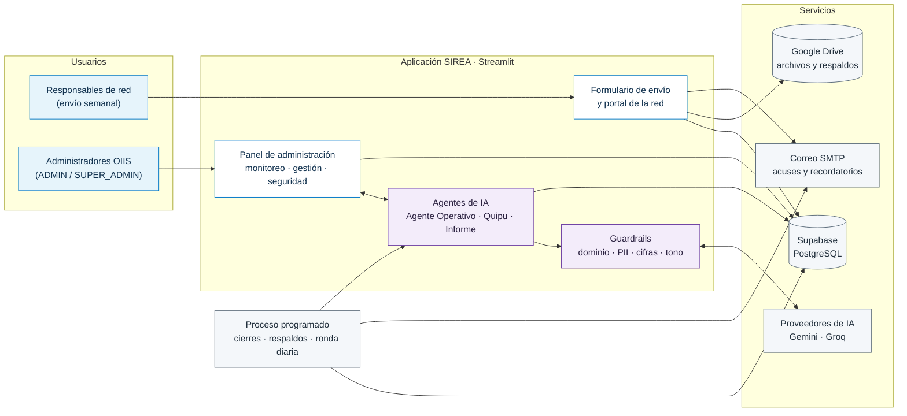
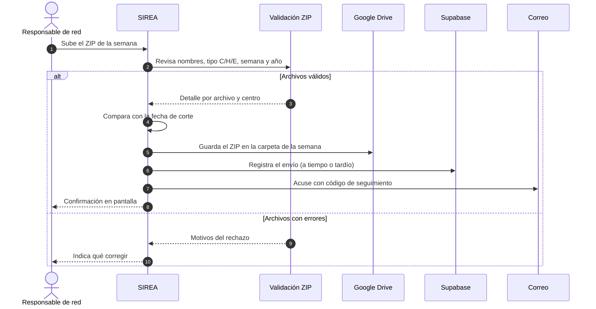
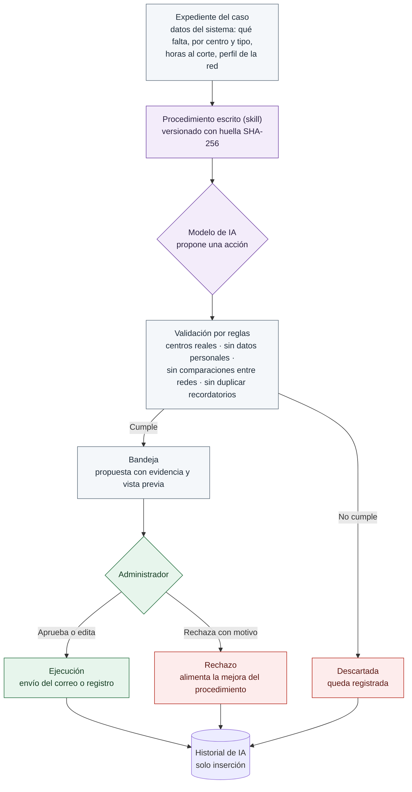
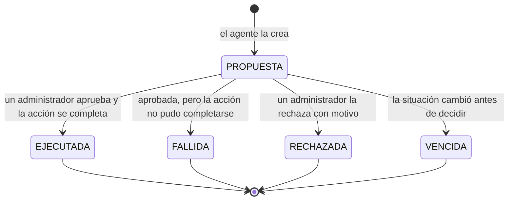
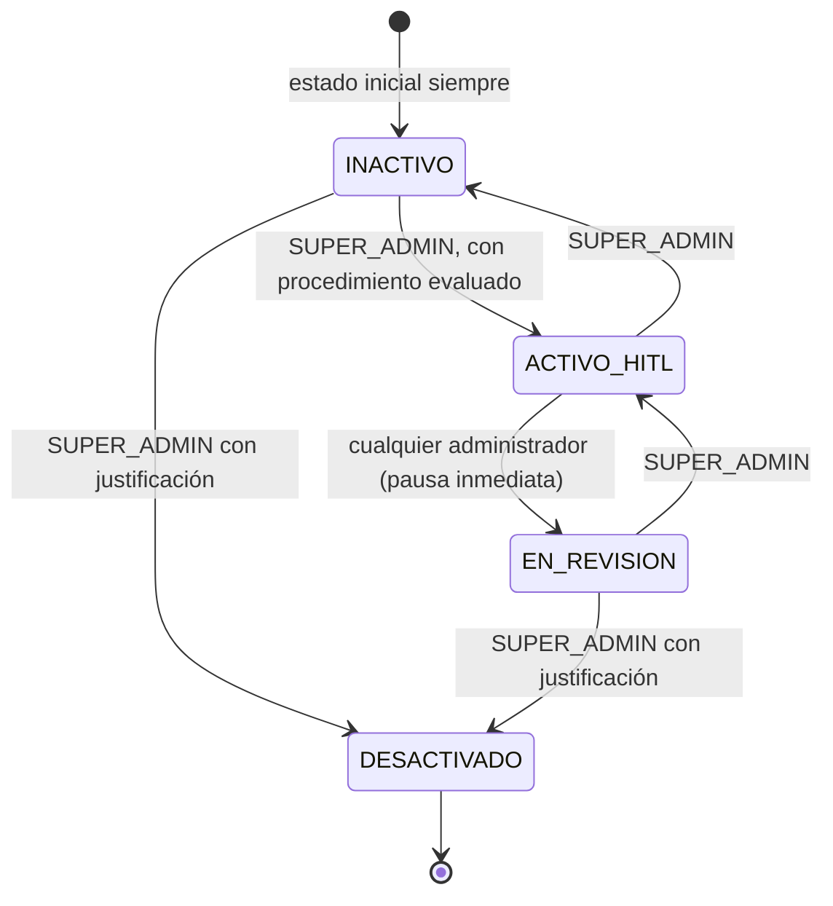
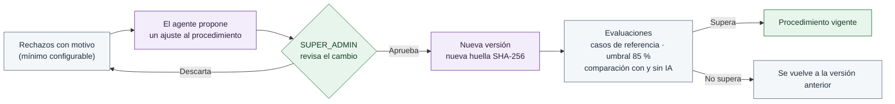
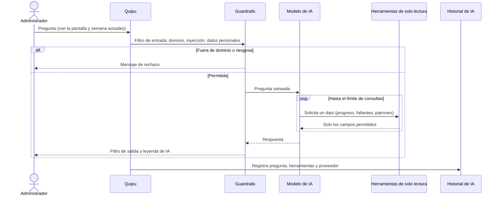
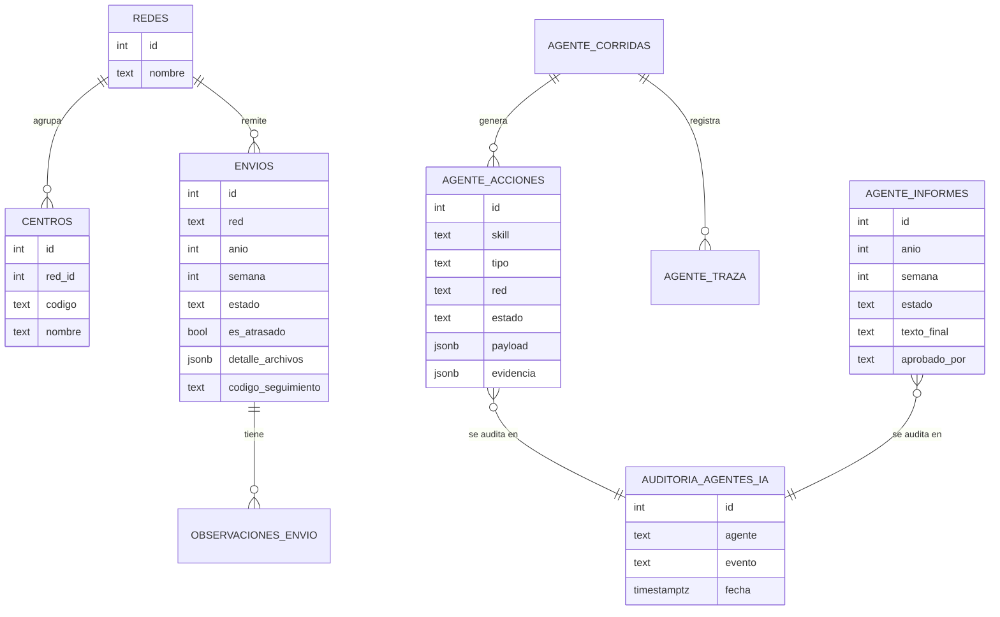
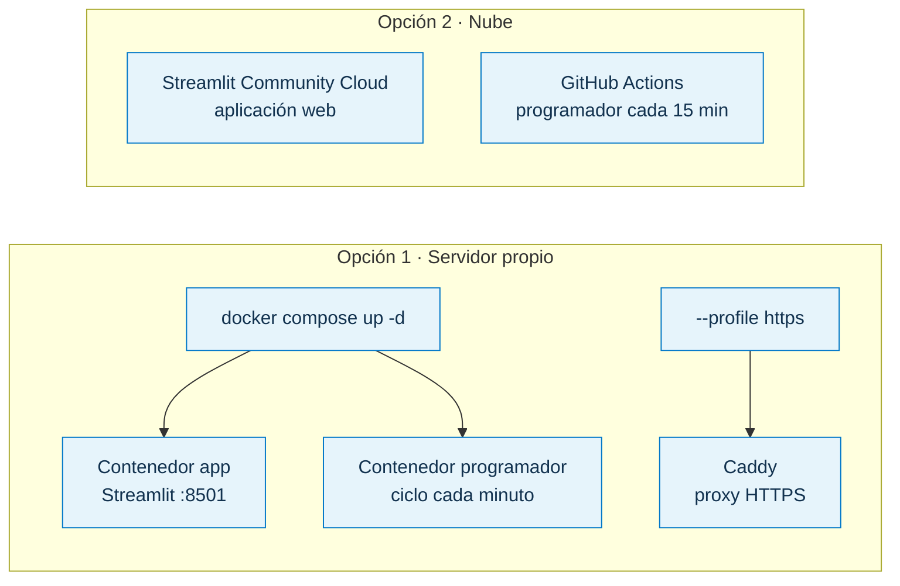

<p align="center">
  
  &nbsp;&nbsp;&nbsp;&nbsp;
  
</p>

<h1 align="center">SIREA</h1>

<p align="center">
  <b>Sistema de Recepción de Reportes Epidemiológicos con Agentes</b><br/>
  Oficina de Inteligencia e Información Sanitaria (OIIS) · Seguro Social de Salud (EsSalud)
</p>

<p align="center">
  
  
  
  
  
</p>
<p align="center">
  
  
  
  
  
</p>

---

## Visión del proyecto

Cada semana, las redes asistenciales de EsSalud remiten a la OIIS sus reportes epidemiológicos:

- **C** · Consulta Externa;
- **H** · Hospitalización;
- **E** · Emergencia.

Antes de SIREA, conocer qué había llegado, qué faltaba y quién debía recibir un recordatorio exigía revisar envíos y correos a mano.

**SIREA** centraliza la recepción, valida automáticamente cada archivo y da a la OIIS el control del cumplimiento en tiempo real. Sobre esa base incorpora **agentes de inteligencia artificial bajo supervisión humana**:

- leen los datos del sistema;
- detectan pendientes y patrones de atraso;
- redactan propuestas: recordatorios formales, informes y revisiones.

Ninguna acción se ejecuta sin la aprobación de un administrador, y todo lo que hace la IA queda en un historial que no se puede modificar ni borrar.

---

## Capacidades principales

| Área | Qué resuelve |
| :--- | :--- |
| **Recepción** | Formulario de envío con archivo ZIP. Valida el tipo de reporte, la semana y el año de cada archivo, controla el plazo según la fecha de corte, envía acuse con código de seguimiento y guarda en Google Drive |
| **Monitoreo** | Panel de control, seguimiento semanal y progreso por red, con filtro común de año, semana y red |
| **Gestión** | Atrasos, duplicados, observaciones, notificaciones con responsables sugeridos, exclusión de centros, cierre de semana y respaldos |
| **Seguridad** | Roles ADMIN y SUPER_ADMIN, permisos por red, bloqueo por intentos fallidos, sesiones persistentes y registros protegidos |
| **Agente Operativo** | Ronda diaria que propone recordatorios, escalamientos y notas. Todo pasa por la Bandeja para su aprobación |
| **Patrones por red** | Cálculo sin IA de qué falta por centro y tipo, qué red suele atrasarse y cuál mejora o empeora |
| **Informe semanal** | Cifras del sistema más una redacción de la IA con cifras verificadas. Se exporta en PDF institucional con marca de agua y en Word |
| **Quipu** | Asistente de consulta flotante en todas las pantallas. Solo lee datos; nunca envía ni modifica |
| **Gobernanza de IA** | Módulo propio con el funcionamiento, las rondas, los procedimientos, las evaluaciones, la memoria, el encendido y apagado y el historial de IA |

---

## Arquitectura general



---

## Flujo de recepción de un envío



---

## Ciclo del Agente Operativo

El agente **propone** y una persona **decide**. Las reglas del sistema revisan cada propuesta antes de que llegue a la Bandeja.



### Estados de una propuesta



### Ciclo de vida de los agentes

El estado se guarda en la base de datos. Si no se puede leer, el agente se considera **INACTIVO**: nunca opera por defecto.



---

## Mejora continua de los procedimientos



---

## Quipu, el asistente de consulta

Su nombre viene del sistema de cuerdas anudadas con el que los incas llevaban sus registros. Quipu responde preguntas sobre los datos de SIREA desde cualquier pantalla, con herramientas de solo lectura y una lista blanca de campos.



---

## Modelo de datos principal



Otras tablas:

- **Sesiones y accesos:** `sesiones_app`, `intentos_login`.
- **Trazabilidad:** `auditoria_acciones`, `logs`.
- **Operación:** `cierres_corte`, `respaldos`, `permisos_operaciones`, `solicitudes_password`.
- **Agentes:** `agente_memoria_red`, `agente_evals`, `agente_skill_versiones`, `agente_atrasos_justificados`.

El detalle de cada script está en [`sql/LEEME.md`](sql/LEEME.md).

---

## Gobernanza de la IA

El diseño sigue los **Principios de IA de la OCDE**.

| Principio | Cómo se aplica en SIREA |
| :--- | :--- |
| **Supervisión humana** | Los agentes proponen; una persona aprueba, edita o rechaza. Arrancan siempre inactivos y solo un SUPER_ADMIN puede activarlos |
| **Transparencia** | Cada propuesta muestra su evidencia y su razonamiento. Los textos de IA llevan leyenda y el PDF del informe dice si fue validado |
| **Robustez y seguridad** | Guardrails de entrada y salida, token canario, verificación de cifras contra el sistema, proveedor de respaldo y comportamiento *fail-closed* |
| **Rendición de cuentas** | Historial de IA en una tabla en la que solo se puede insertar, con usuario, decisión y motivo. Los disparadores impiden editar informes y decisiones |
| **Proporcionalidad** | Cada procedimiento se evalúa contra su versión sin IA; los asistentes que no aportaban se retiraron con la decisión documentada |
| **Privacidad** | Herramientas con lista blanca de campos, detección de datos personales y comparaciones entre redes reservadas al uso interno |

Marco completo, matriz de riesgos y controles: [`docs/GOBERNANZA_SIREA.md`](docs/GOBERNANZA_SIREA.md).

---

## Tecnologías

| Capa | Tecnología |
| :--- | :--- |
| Interfaz y servidor | Python 3.12 · Streamlit 1.64 |
| Base de datos | Supabase (PostgreSQL) |
| Archivos | Google Drive API (cuenta de servicio) |
| Correo | SMTP (Google Workspace / Gmail) |
| Inteligencia artificial | Google Gemini (principal) · Groq (respaldo) |
| Documentos | openpyxl · python-docx · reportlab |
| Despliegue | Docker Compose · Caddy (HTTPS) · Streamlit Community Cloud con GitHub Actions |
| Pruebas | pytest · Playwright |

---

## Estructura del proyecto

```
sirea/
├── app.py                     Punto de entrada
├── app_pages/                 Pantallas: envío, portal de red, panel y módulos
│   ├── admin.py               Menú, sesión y despacho de secciones
│   ├── admin_agentes_ia.py    Módulos «Agente de IA» y «Gobernanza de IA»
│   ├── filtro_periodo.py      Filtro común de año, semana y red
│   └── quipu.py               Asistente de consulta flotante
├── src/
│   ├── agentes/               Agentes, skills, guardrails, evaluaciones, patrones, auditoría
│   │   ├── skills/            Procedimientos escritos de los agentes
│   │   └── casos_eval/        Casos de evaluación
│   ├── db_manager.py          Acceso a Supabase
│   ├── drive_manager.py       Google Drive
│   ├── email_sender.py        Correos y plantillas
│   ├── informe_pdf.py         Informe semanal en PDF institucional
│   ├── programador.py         Proceso programado
│   └── zip_processor.py       Validación de archivos recibidos
├── utils/                     Tema visual y componentes de interfaz
├── sql/                       Scripts de base de datos
├── scripts/                   Secretos para la nube y datos de demostración
├── tests/                     Pruebas automáticas y recorrido en navegador
├── docs/                      Gobernanza, despliegue y lista de verificación
├── assets/                    Logos institucionales
├── Dockerfile
├── docker-compose.yml
└── requirements.txt
```

---

## Instalación

### Requisitos

- Python 3.12 o superior.
- Un proyecto de Supabase. Se recomienda uno de demostración, separado de producción.
- Una cuenta de servicio de Google con acceso a las carpetas de Drive.
- Una cuenta de correo con contraseña de aplicación (SMTP).
- Una clave de Gemini. La de Groq es opcional, como respaldo.

### Pasos

```bash
git clone <url-del-repositorio> sirea
cd sirea
python -m venv venv
source venv/bin/activate          # Windows: venv\Scripts\activate
pip install -r requirements.txt
cp .env.example .env              # completar los valores marcados con <<< COMPLETAR
```

**Base de datos:** en Supabase, abra **SQL Editor** y ejecute `sql/ACTUALIZAR_TODO_SIREA_3_2.sql`.

- Es idempotente: se puede ejecutar más de una vez y no borra datos.
- Al terminar verifica que existan todas las tablas.
- La versión 3.3 no requiere cambios adicionales en la base.

```bash
python verificar_despliegue.py    # comprueba base de datos, Drive, correo y proveedores de IA
streamlit run app.py              # http://localhost:8501
```

### Variables principales

| Variable | Descripción |
| :--- | :--- |
| `SUPABASE_URL`, `SUPABASE_KEY` | Proyecto de Supabase (clave service_role) |
| `GOOGLE_CREDENTIALS_PATH`, `GOOGLE_DRIVE_FOLDER_ID` | Cuenta de servicio y carpetas de Drive |
| `EMAIL_REMITENTE`, `EMAIL_PASSWORD`, `EMAIL_ADMINS` | Correo de envío y destinatarios de alertas |
| `SUPERADMIN_PRINCIPAL` | Usuario SUPER_ADMIN principal |
| `GEMINI_API_KEY`, `GROQ_API_KEY` | Proveedores de IA |
| `AGENTE_PROGRAMADO`, `AGENTE_HORA` | Ronda diaria del Agente Operativo |
| `PATRONES_SEMANAS`, `PATRONES_MIN_SEMANAS` | Ventana y mínimo para calcular patrones |
| `ASISTENTE_LIMITE_HORA` | Preguntas por hora y sesión a Quipu |

La plantilla `.env.example` documenta todas las variables.

---

## Despliegue



| Opción | Guía |
| :--- | :--- |
| Servidor Linux con Docker | [`GUIA_DESPLIEGUE_SERVIDOR.md`](GUIA_DESPLIEGUE_SERVIDOR.md) |
| Windows con Docker | [`GUIA_DESPLIEGUE_WINDOWS.md`](GUIA_DESPLIEGUE_WINDOWS.md) |
| Streamlit Community Cloud | [`docs/DESPLIEGUE_STREAMLIT_CLOUD.md`](docs/DESPLIEGUE_STREAMLIT_CLOUD.md) |

Los secretos nunca van en el repositorio. Están excluidos en `.gitignore`:

- `.env`;
- `credentials/`;
- `.streamlit/secrets.toml`.

---

## Pruebas

```bash
pytest -q
```

Las pruebas usan un Supabase simulado y no requieren red ni claves. Cubren:

- recepción;
- sesiones;
- guardrails;
- proveedores de IA;
- Agente Operativo;
- patrones;
- informe semanal y PDF.

Recorrido completo en navegador con Playwright:

```bash
python -m streamlit run tests/smoke_app.py --server.port 8599 --server.headless true
python tests/smoke_browser.py http://localhost:8599
```

**Datos de demostración** (solo para bases de prueba):

- `scripts/sembrar_historial_demo.py`;
- `sql/DEMO_semana_40_datos_sinteticos.sql`.

Todo lo simulado queda marcado como `DEMO-SIM`, usa correos del dominio reservado `example.org` y tiene su opción de borrado.

---

## Documentación

| Documento | Contenido |
| :--- | :--- |
| [`CAMBIOS_SIREA.md`](CAMBIOS_SIREA.md) | Historial de versiones |
| [`docs/GOBERNANZA_SIREA.md`](docs/GOBERNANZA_SIREA.md) | Marco de gobernanza de la IA, riesgos y controles |
| [`docs/CHECKLIST_PRUEBA_REAL.md`](docs/CHECKLIST_PRUEBA_REAL.md) | Lista de verificación para pruebas con datos reales |
| [`sql/LEEME.md`](sql/LEEME.md) | Scripts de base de datos y orden de ejecución |

---

<p align="center">
  Desarrollado para la Oficina de Inteligencia e Información Sanitaria (OIIS) · EsSalud<br/>
  Uso institucional. Los logotipos de EsSalud y de la OIIS pertenecen a sus respectivos titulares.
</p>
